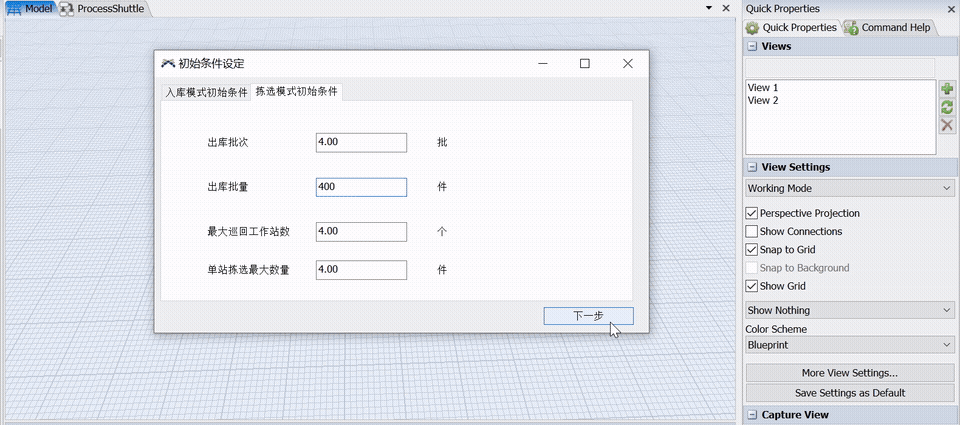
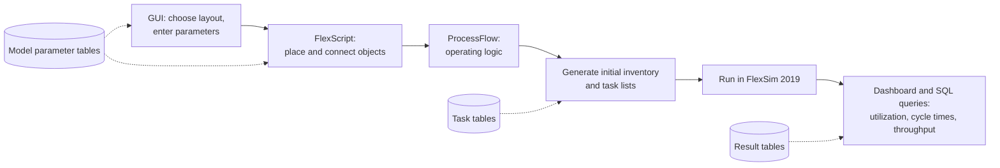
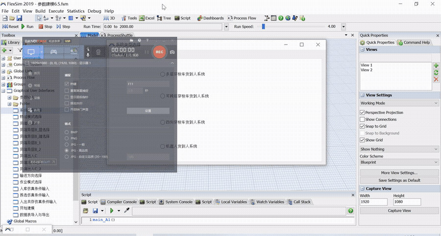
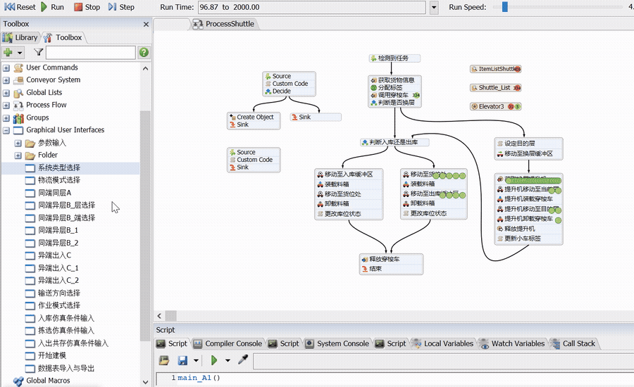
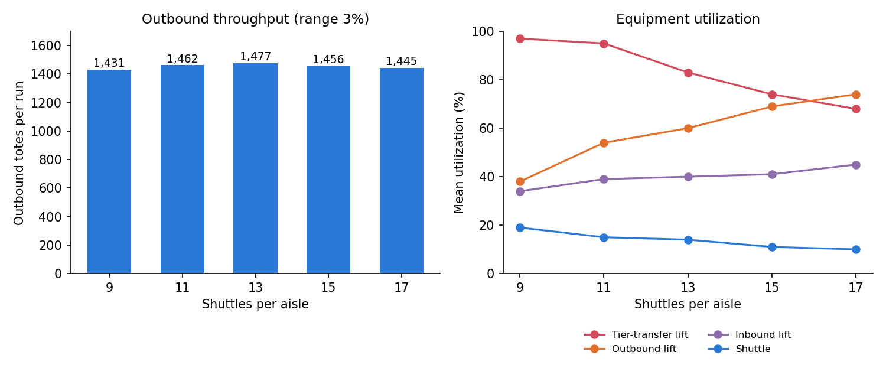

# Automatic FlexSim model builder for shuttle-based storage systems

B.Eng. thesis, University of Science and Technology Beijing, 2021. Advisor: Assoc. Prof. Wang Zhuan.



A tier-to-tier shuttle storage system has racks, shuttles that run along each tier, lifts that move
shuttles and totes between tiers, conveyors and picking stations. To compare designs in simulation,
the usual approach is to build each FlexSim model by hand. A different layout or a different number
of shuttles means rebuilding much of the model, which takes days and is easy to get wrong.

This project builds the model automatically. The user picks a layout and enters the dimensions and
equipment parameters in a GUI. FlexScript code then places every object, connects them and sets up the
operating logic, so the model is ready to run. A dashboard and SQL queries collect the results.

- 60 layout configurations, combined from 3 flow patterns and 8 flow directions, described by about
  100 parameters. 30 are built by their own command sets; the other 30 are mirror images of these.
- 158 user commands, about 12,000 lines of FlexScript. Each layout calls 20 of them, and the shared
  ones are kept in a `CommonUse` folder. The code is in [`src/`](src).
- 14 data tables in 4 groups, with Excel import and export
- One ProcessFlow serves all 60 layouts, so the operating logic is written once

## Workflow



| Step | What happens |
|---|---|
| Parameter input | A multi-page GUI: system type, flow pattern, layout code, flow direction, then 7 parameter pages (storage unit, racks, conveyors, picking stations, lifts, shuttles, tote infeed), operating mode and initial conditions. |
| Model generation | User commands compute the coordinates of racks, lifts, shuttles and conveyors from the parameters and create the objects from a user library. |
| Operating logic | A single ProcessFlow handles storage, retrieval, tier changes, batch release and overdue tasks. When tasks pile up they are reordered as returns first, then storage, then retrieval, so a batch of retrievals does not block the conveyor. |
| Results | Data collectors record each machine's state times. SQL queries over these tables give utilization, mean cycle time and mean capacity per machine group. |



### Placement rules

Each object type has a placement rule written in terms of the objects already placed. Racks come
first, from the rack width, aisle width and back-to-back gap. Buffers, lifts and shuttles are then
placed relative to the racks, and conveyors relative to the lifts. For example, the shuttles of
aisle *i* sit midway between rack rows 2*i*-1 and 2*i*, and a shuttle that starts on tier *j* is
placed at that tier's height:

```
S_x(i) = R_x(2i - 1)
S_y(i) = (R_y(2i - 1) + R_y(2i) - 0.5) / 2
S_z(j) = CH * (j - 1)          CH = tier height, j = tier
```

Because every rule depends only on parameters and on earlier objects, changing one dimension
moves everything downstream with it. The rules for all equipment are in
[`media/slides/`](media/slides) (slides 37-40, in Chinese).

## Data design

14 FlexSim global tables in 4 groups:

| Group | Tables | Filled by |
|---|---|---|
| Model parameters | storage unit, rack system, conveyor system, lifts and shuttles, initial conditions, layout selection | the GUI |
| Simulation run | initial inventory, storage tasks, retrieval tasks | generated by user commands, or imported from Excel |
| Simulation tasks | location status, tote management | updated during the run |
| Simulation results | equipment state times, equipment utilization, system indicators | data collectors and SQL queries |

Utilization is computed in FlexScript with SQL queries on the data-collector tables
(simplified from the model):

```c
Table a = Table.query("Select Idle From [TaskExecuterBarChart]");
Table b = Table.query("Select OffsetTravelEmpty From [TaskExecuterBarChart]");
Table c = Table.query("Select OffsetTravelLoaded From [TaskExecuterBarChart]");
Table d = Table.query("Select Loading From [TaskExecuterBarChart]");
Table e = Table.query("Select Unloading From [TaskExecuterBarChart]");
double asum = 0, bsum = 0, csum = 0, dsum = 0, esum = 0;
for (int i = 1; i <= a.numRows; i++) {
    asum += a[i][1]; bsum += b[i][1]; csum += c[i][1]; dsum += d[i][1]; esum += e[i][1];
}
double utilization = (bsum + csum + dsum + esum) / (asum + bsum + csum + dsum + esum);
```



## Experiment: shuttles per aisle

Layout AL1 (inbound and outbound on the same end and tier), 10 rows x 20 columns x 20 tiers,
double-deep racks, 3 picking stations, mixed storage and retrieval. Only the number of shuttles per
aisle changes. Every scenario uses the same task lists, and each value is the mean of 20 replications.



| Shuttles per aisle | 9 | 11 | 13 | 15 | 17 |
|---|---|---|---|---|---|
| Outbound totes | 1,431 | 1,462 | 1,477 | 1,456 | 1,445 |
| Shuttle utilization | 19% | 15% | 14% | 11% | 10% |
| Tier-transfer lift utilization | 97% | 95% | 83% | 74% | 68% |
| Outbound lift utilization | 38% | 54% | 60% | 69% | 74% |

Outbound throughput stays within 3% across all five fleet sizes, while shuttle utilization halves.
With few shuttles, more tasks need a tier change, and the tier-transfer lift runs at 97%. Adding
shuttles moves the load onto the outbound lift instead. The shuttles are never the constraint; the
lifts are. Data: [`results/fleet_size_experiment.csv`](results/fleet_size_experiment.csv).

### Limitations

- Only means were reported. With 20 replications per scenario, confidence intervals should have
  been computed before reading anything into a 1-3% difference in throughput.
- The utilization statistic counts empty travel as busy time. This may be why outbound-lift
  utilization nearly doubles while outbound throughput does not change. Loaded travel, empty travel
  and blocked time should be reported separately.
- The thesis recommends 9 shuttles per aisle, but a lift at 97% utilization leaves almost no slack
  for demand peaks. A queueing measure such as task waiting time would be needed to support that choice.
- The model was not validated against an operating warehouse. Equipment speeds and dimensions are
  design values.

## Files

| Path | Content |
|---|---|
| `model/sbsrs_automodel.fsm` | The FlexSim model with the GUI, user commands and ProcessFlow. Opens in FlexSim 2019 or later. |
| `model/lib19.fsl` | Object library loaded by the `lib()` command. Its path is fixed in the code; change it to where you put the file. |
| `src/` | The user commands, button scripts and custom ProcessFlow code, extracted as plain files so they can be read without FlexSim. See [`src/README.md`](src/README.md). |
| `media/slides/` | Figures from the defense slides (Chinese labels): layout patterns, equipment coordinates, ProcessFlow. |
| `results/` | Fleet-size results from the thesis tables and the script that draws the chart. |
| `tools/extract_flexscript.py` | Reads the binary `.fsm` file and writes the user commands to `src/`. Written later for this repository, not part of the thesis. |

To try it, open the model in FlexSim, open the GUI `系统类型选择` (system type selection) under
Toolbox > Graphical User Interfaces, and follow the pages.

## License

MIT. The thesis and slides are in Chinese; this summary was written for the repository.

The FlexSim model and its FlexScript are my own thesis work. The extraction script in `tools/` and
this README were written later with the help of an AI coding assistant.
